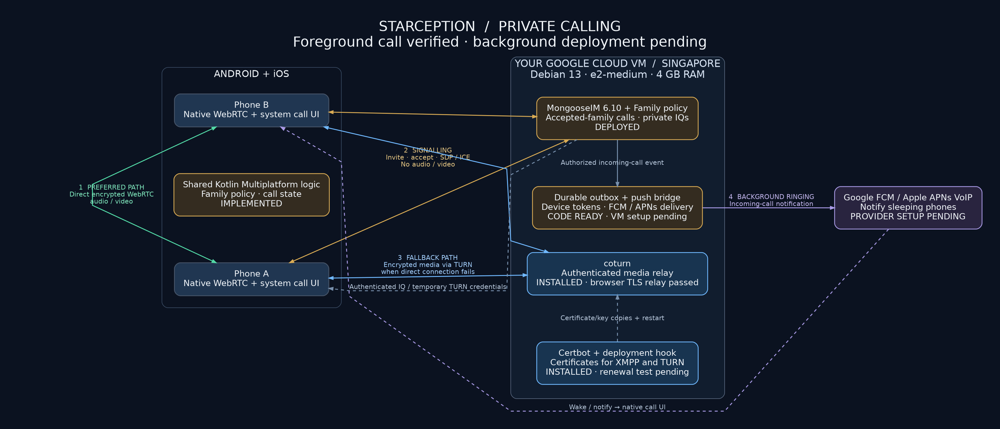
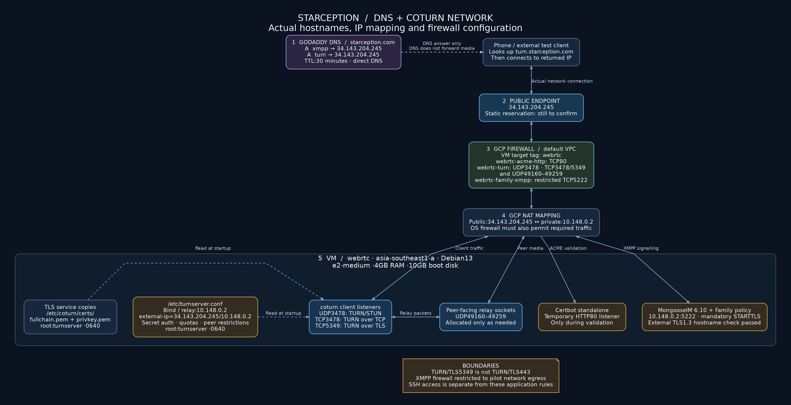
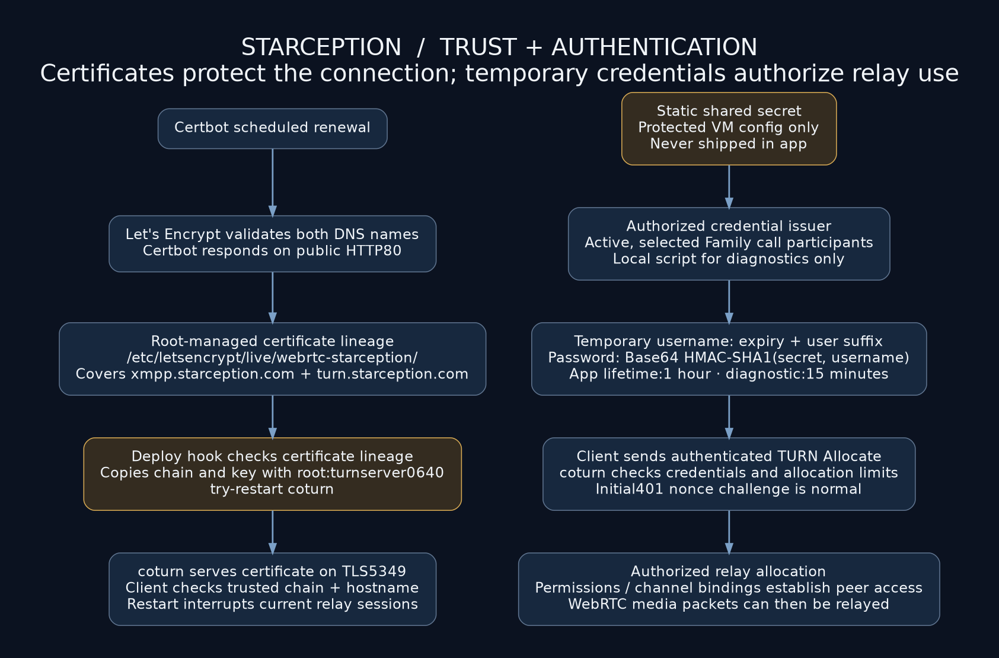

# Starception architecture diagrams

Read these in order: the first explains the call paths, the second maps them to DNS and the actual VM, and the third explains certificate trust and TURN authorization. These are architecture views, not evidence that all planned components are deployed.

## 1. Calling system overview



[Open scalable SVG](images/calling/architecture.svg) · [Editable Graphviz source](images/calling/architecture.dot)

- **Green:** direct encrypted WebRTC audio/video, preferred when connectivity permits.
- **Gold:** deployed MongooseIM 6.10.0 and Family policy, shared call state, and authenticated TURN issuance. Foreground Android-to-iOS calling was confirmed.
- **Blue:** installed coturn relay and certificate tooling. UDP/TCP utility tests and independent relay-only TLS browser data delivery passed; native forced-relay media quality and renewal testing remain separate checks.
- **Purple:** background push outbox/bridge and native call integration are implemented in code. VM/Firebase deployment is pending; iOS delivery also needs paid Apple/APNs configuration.

XMPP carries invitations and negotiation messages, not media. The two phones can use a direct media path or select coturn. Shared KMP code handles client logic; native adapters handle media, Android call integration and iOS CallKit/PushKit.

The server-to-phone credential arrow represents authenticated XMPP IQs returning temporary TURN credentials. Firebase identity bootstrap remains future work. The static secret stays on the VM. The certificate hook arrow represents local file deployment/restart, not network media traffic.

## 2. DNS, public address, firewall and coturn



[Open scalable SVG](images/calling/network-and-dns.svg) · [Editable Graphviz source](images/calling/network-and-dns.dot)

Follow the numbered path:

1. **GoDaddy DNS:** A records for `xmpp` and `turn` resolve to `34.143.204.245`, with a 30-minute TTL. This is a simplified DNS view; clients normally use a recursive resolver to obtain the authoritative answer. DNS does not proxy call packets.
2. **Public endpoint:** clients connect to the returned IP. Its static reservation still needs confirmation.
3. **GCP firewall:** rules target the VM's `webrtc` network tag. TCP 80 is for certificate validation; UDP/TCP 3478 and TCP 5349 are TURN listeners; UDP 49160–49259 is the peer-facing relay range. `webrtc-family-xmpp` permits TCP 5222 from the pilot Wi-Fi/Cloud Shell source addresses.
4. **NAT mapping:** coturn binds `10.148.0.2` and advertises `34.143.204.245`, using `external-ip=34.143.204.245/10.148.0.2`. This is a logical view of controls and address mapping, not a literal ordering of Google's internal packet-processing stages.
5. **VM services:** coturn reads protected config/certificate files. Certbot opens a temporary HTTP listener for validation. MongooseIM subsequently deployed on `10.148.0.2:5222`; external STARTTLS/hostname verification passed over TLS 1.3.

A client-to-TURN TCP/TLS connection still needs reachable UDP peer relay sockets. TLS 5349 does not provide access on networks allowing only port 443. SSH administration uses a separate access path/rule and is not opened by these application rules.

## 3. Certificates and temporary authentication



[Open scalable SVG](images/calling/certificates-and-auth.svg) · [Editable Graphviz source](images/calling/certificates-and-auth.dot)

**Left column: certificate lifecycle.** Certbot validates both names, writes root-managed certificate files, then invokes the deployment hook. The hook copies only the required files with `root:turnserver` ownership and mode `0640`, then restarts an active coturn service. This interrupts current relay sessions. Renewal testing remains pending.

**Right column: relay authorization.** The deployed Family module issues temporary credentials only to selected participants in an active accepted-family call. The local Python script remains useful for diagnostics. coturn checks credentials and quotas before allocating relay sockets and accepting peer permissions/channel bindings.

Certificates establish trusted TLS server identity. Temporary credentials authorize relay use. They solve different problems; one does not replace the other.

## Commands and verification

The [setup record](CALLING_SETUP_RECORD.md) indexes completed commands and live evidence. The [coturn runbook](COTURN_SETUP_RUNBOOK.md) explains the original relay setup, and [background calling](BACKGROUND_CALLING.md) documents pending push deployment. The [browser test](../tools/turn-relay-test.html) passed relay-only TLS delivery with 200 messages received and echoed.

To regenerate the illustrations from the repository root with Graphviz installed:

```bash
for name in architecture network-and-dns certificates-and-auth; do
  dot -Tsvg "docs/images/calling/$name.dot" \
    -o "docs/images/calling/$name.svg"
  dot -Tpng -Gdpi=110 "docs/images/calling/$name.dot" \
    -o "docs/images/calling/$name.png"
done
```

SVG remains sharp when zoomed. PNG is convenient for sharing. The source contains no passwords, private keys or TURN shared secret.
