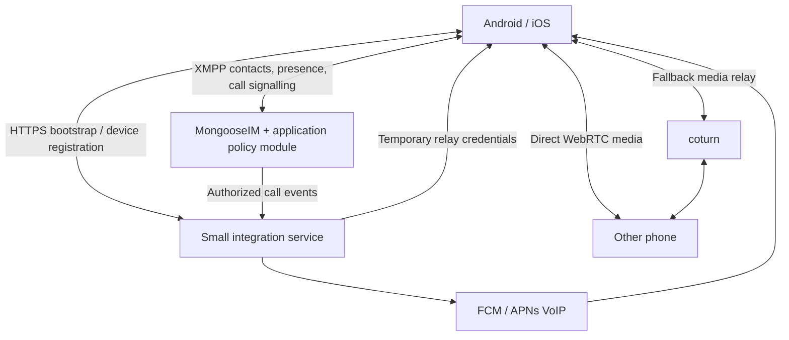

# Private calling design — reviewed baseline

Status: reviewed production design. Family calling, native call screens, a durable push outbox, Android FCM/Telecom and optional iOS PushKit/CallKit are in the repository; see [Family calling](FAMILY_CALLING.md) and [background deployment](BACKGROUND_CALLING.md) for implementation scope and validation. Foreground cross-platform calling was confirmed on devices. Background provider configuration and signed-device acceptance remain necessary; production identity/bootstrap is still planned. This document replaces the earlier Go/LiveKit group-first proposal.

## Scope and selection

Phase one: private one-to-one voice and video between mutually accepted contacts. Group calls are a later phase.

Selected candidate: MongooseIM for XMPP, coturn for relay, and one small application integration service for identity bootstrap, device registration, TURN credentials and platform push. A MongooseIM extension enforces call policy and authoritative call state. These are responsibilities to implement and verify, not features assumed present in a stock installation.

MongooseIM is a reasonable candidate, not a benchmark winner over ejabberd. Its Erlang/OTP implementation fits the desired stack. The upstream COPYING contains GPLv2 with an OpenSSL linking exception. Private hosting as a separate service does not itself require publishing an independent mobile app. Redistribution and modified modules require appropriate licence review. This choice does not avoid GPL.

## Topology

No separate generic SDP signalling server, RabbitMQ, Redis or SFU is planned for phase one. Select a persistence backend supported by the pinned MongooseIM release; do not assume all modules support the same database. The choice of application persistence is made with that module matrix. Keep durable call state and a transactional notification outbox in the application policy layer's supported store. Push workers retry the outbox without owning a competing copy of call state.

XMPP carries call invitations, accept/reject/cancel, session negotiation and hang-up. Native WebRTC carries encrypted audio/video directly when possible; coturn relays encrypted packets when necessary. Presence alone does not establish call eligibility or reliable reachability.

## Responsibilities that XMPP does not remove

1. Map authenticated app identities to durable XMPP accounts and revoke sessions on logout/device removal.
2. Check mutual contact acceptance and blocks on the server before forwarding call requests or allocating relay access.
3. Persist call deadlines, terminal state and per-device answer ownership.
4. Register device push tokens and deliver time-sensitive incoming-call notifications through Google/Apple.
5. Issue short-lived TURN credentials and apply quotas.
6. Recover current call state after reconnect so delayed events cannot restart a finished call.

Implement policy and state through a MongooseIM module, or move them into the integration service if the selected extension API makes durable transactions impractical. Either choice requires explicit authorization tests. Reducing process count shifts responsibility into an extension; it does not remove the work.

## Signalling protocol and interoperability gate

Evaluate Jingle session negotiation (XEP-0166), RTP applications (XEP-0167), ICE-UDP (XEP-0176), Jingle Message Initiation (XEP-0353), stream management (XEP-0198), and external service discovery (XEP-0215).

Jingle negotiation is primarily client functionality. A server routing XML is not evidence that native WebRTC calls interoperate. Verify compatible DTLS fingerprints, codecs, ICE candidates/trickle ICE, media direction and restart handling. Standard Jingle includes media descriptions that require translation to/from native WebRTC SDP; do not simply put an arbitrary SDP string in a Jingle stanza and claim interoperability.

Before choosing libraries, prove an Android-to-iOS call and reconnect with maintained libraries and acceptable licences. A KMP XMPP library that supports chat may lack Jingle. Use native XMPP adapters if necessary. If standard Jingle support is inadequate, explicitly design a versioned private call protocol over XMPP for this closed app, including SDP/ICE messages, and acknowledge that it will not interoperate with general Jingle clients.

All events carry a call ID, event ID, protocol version and expiry. Server state carries a monotonically increasing version. Authoritative state commands use authenticated XMPP IQs through the policy module, with bounded retries and request IDs. Permit clients to query their current call/invitation snapshot. Reliable stream acknowledgements do not prove a phone rang or a person answered.

## Call state and contacts

Call state: ringing -> active -> ended; ringing can also terminate as cancelled, declined, busy or expired. Use server time and a bounded ringing deadline (initial target: 45 seconds). Track per-user and per-installation participation. Enforce two distinct users and one winning installation per user in phase one. Keep participant collections in protocol models for future groups.

Persist the state transition and notification work atomically. Deduplicate commands and events. Reject acceptance after cancellation/expiry. Concurrent answers from two devices select one winner and stop ringing the others. Reconnect queries current state before presenting or resuming a call.

Roster/presence subscription alone is insufficient for a friends-only product. Define mutual acceptance as the server's canonical relationship rule, enforce blocks in both directions, and guard raw XMPP calls/presence against policy bypass. Disable public registration/federation unless explicitly needed. A known JID grants no calling right.

A server can prevent unauthorized signalling and relay allocation, but cannot forcibly terminate a direct peer-to-peer media connection once established if both modified clients ignore termination. Normal clients must end media immediately on a block/revoke/end event. Do not promise SFU-style centralized media termination for a peer-to-peer design.

## Identity and integration service

Reuse the same real Firebase project across platforms if retaining the Android app's existing Firebase identity. Verify ID tokens server-side; never trust a client-provided UID. iOS identity integration is still required. Map to opaque durable JIDs; do not assume a Firebase token is an XMPP password or that matching email strings link accounts.

Required small HTTPS surface:

| Operation | Purpose |
| --- | --- |
| Authenticated bootstrap | Resolve/provision XMPP identity and return its secure connection credentials |
| Installation registration/removal | Bind FCM and APNs VoIP tokens and environment to a signed-in account/device |
| TURN credential issuance | Authorize call participation and return short-lived relay credentials |
| Private call-event intake | Receive verified policy-module events for push delivery; never public arbitrary push injection |

Prefer device-specific revocable XMPP credentials when supported by the chosen integration. Otherwise document account-wide password rotation behavior and explicitly terminate revoked device sessions. Evaluate supported MongooseIM auth methods for the pinned release rather than assuming ejabberd auth options apply.

The service language is not a KMP requirement: a compact Go service or Kotlin/Ktor service can fulfill these roles. Choose after profiling the complete deployment; using Kotlin consistently may simplify maintenance while a JVM adds baseline memory.

## Push and mobile lifecycle

The bridge receives durable, authorized incoming-call work and sends FCM for Android or APNs VoIP for iOS. It does not transport media. Store minimal caller display data/call ID in pushes, never credentials or SDP. Retry only while the invitation is valid; remove invalid tokens and retain a bounded delivery audit without sensitive payloads.

Presence can be stale. Choose delivery rules that do not rely exclusively on an online flag: send genuine incoming-call push with deduplication, or use a short acknowledgement window before push fallback. Test platform behavior and avoid duplicate UI from socket/push delivery.

MongooseIM push components may help, but verify exact support for genuine incoming-call VoIP pushes. Ordinary XMPP mobile push support is not proof of PushKit/CallKit integration. Push delivery remains best effort; force-stopped/restricted devices cannot be promised ringing.

Android: one coordinated Firebase messaging ingress, high-priority short-lived pushes for real calls, CallStyle/system call integration, notification permission and legal foreground-service startup. The app currently targets SDK36/minSdk28; account for while-in-use microphone/camera restrictions. Start capture only in a permitted accepted-call flow. Do not use WorkManager for live ringing or assume full-screen intents are available on every installation.

iOS: promptly report valid incoming VoIP pushes to CallKit before waiting for network reconciliation, complete the PushKit callback, then end stale calls through CallKit. APNs VoIP pushes are for real incoming calls, not generic state/presence/cancellation events. Register the correct VoIP topic, sandbox/production environment and signing capabilities. Answer/reject and audio activation follow CallKit lifecycle. Real signed devices are required for acceptance testing.

## Kotlin Multiplatform integration

Create a small protocol/domain KMP module consumable by both apps; Android currently does not depend on the existing iOS-oriented shared UI host. Share contacts models, call state reduction, event validation, request correlation, deadlines and reconnect rules. Keep native SDK/media objects out of common code.

Provide native adapters for XMPP transport when required, WebRTC, Firebase identity, secure credential storage, push registration and system call management. Android uses Kotlin/platform APIs; iOS uses Swift/CallKit/PushKit/AVAudioSession. Pin compatible maintained WebRTC distributions and audit their licences; native WebRTC binary packaging is an explicit dependency decision.

Use one process-level call coordinator per platform. Screens observe its state; navigation must not create duplicate sockets, tracks or rooms. Implement microphone mute, camera toggle/switch, audio route, reconnect and hang-up. Stop unsupported background video capture and release all capture/render/audio resources on terminal paths.

Central audio ownership is essential in this app: Quran playback, driving audio, TTS and speech recognition must yield during calls. Existing Android helpers may force microphone/Bluetooth routing; existing iOS speech/audio helpers may change or deactivate AVAudioSession. Restore a defined playback policy after calls. Shared KMP state does not replace native audio/session handling.

## VM deployment requirements

VM access is pending. Record hostname/IP, SSH identity, OS, existing services, available disk, domain and firewall settings before installation. The known shared-core4GB Singapore VM is a pilot target, not a verified call-capacity figure.

Pin MongooseIM/coturn/integration-service releases and exact configuration. Verify required modules/auth/storage against that release. Keep configuration/secrets outside source control, persistent stores separate, logs bounded, service restart policies enabled and time synchronized.

| Exposure | Requirement |
| --- | --- |
| XMPP client endpoint | TLS TCP5222 or WebSocket over HTTPS443, according to tested clients |
| Integration HTTPS | TCP443 with valid publicly trusted certificate |
| TURN UDP/TCP | Typically3478, only configured transports enabled |
| TURN TLS | Typically5349; validate cert renewal and client trust |
| TURN relay range | Explicit bounded UDP relay ports matching coturn configuration/firewalls |
| Administration/metrics | Private/localhost; never unrestricted on the public interface |

TURN listeners alone are insufficient: the relay port range must also be reachable. On GCP NAT, configure coturn's external/public-to-private address mapping correctly and inspect selected ICE candidates. Use expiring shared-secret TURN credentials, allocation/user/total bandwidth quotas, and deny inappropriate relay peers so it cannot become an open relay.

Networks permitting only443 need TURN/TLS443. Sharing one IP/port with HTTPS requires a tested Layer4 SNI proxy and compatible clients, or a separate IP. Ordinary HTTP reverse proxying cannot forward arbitrary TURN/TLS. A pilot on5349 must document its restrictive-network limitation.

Use a small supported datastore configuration, bounded retention and supported consistent backups. Test restore, restart, token rotation and certificate renewal. Do not assume live database file copying preserves pending writes.

## Cost and later groups

Direct one-to-one calls normally avoid server media egress, but relay usage depends on real networks. A call with each phone sending1Mb/s produces roughly2Mb/s of coturn outbound traffic, or0.9GB/hour before overhead. Measure rather than promise a relay percentage. Compute, disk, public IP and egress still have potential GCP charges; billing alerts are not spending caps.

Monitor idle RAM/CPU, socket counts, reconnect rate, push/outbox latency, TURN allocations/bytes and mobile setup time, packet loss, RTT, battery and thermal behavior. Test representative relayed concurrency alongside any services already on the VM.

Later groups require an SFU such as LiveKit. XMPP can retain contacts and invitations, but group media uses the SFU's SDK/signalling path. Preserve a native media adapter boundary now. This is future integration work; adding an SFU is not a zero-change extension to peer-to-peer Jingle. Revisit VM sizing and bandwidth before enabling groups.

## Implementation and acceptance gates

1. Validate identity/account mapping and library licences; prove native Android/iOS WebRTC and XMPP interoperability.
2. Implement mutual contacts/blocks, authoritative call-state extension and integration/push bridge.
3. Deploy staging MongooseIM/coturn with valid TLS and temporary credentials.
4. Prove mixed-platform direct and forced-relay calls, then background incoming calls on real devices.
5. Test duplicate/out-of-order events, simultaneous answers, cancelled/expired invitations, denied permissions, network handover, audio interruptions, server restarts and revoked credentials.
6. Load/soak test with measured memory, media egress and mobile heat; set pilot limits from results.

No production readiness claim is made before these gates pass. The immediate next task is the Android/iOS signalling proof, followed by VM-specific configuration using the supplied access/domain details.

## Sources

- MongooseIM: https://github.com/esl/MongooseIM
- MongooseIM licence: https://github.com/esl/MongooseIM/blob/master/COPYING
- coturn: https://github.com/coturn/coturn
- XMPP protocol specifications: https://xmpp.org/extensions/
