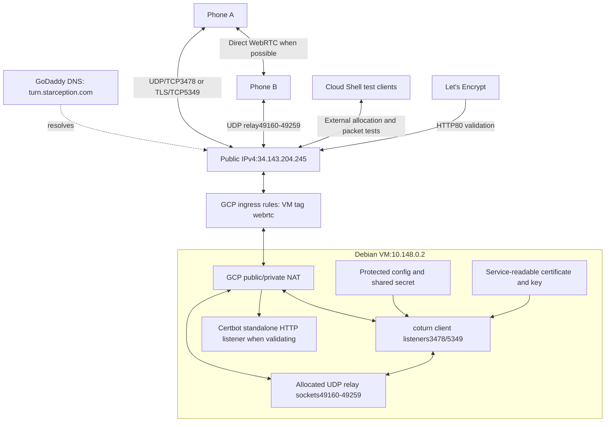

# Starception coturn: detailed setup and operations runbook

For illustrated views, start with the [architecture diagram guide](CALLING_ARCHITECTURE_DIAGRAMS.md): full call flow, GoDaddy DNS/firewall/NAT mapping, and certificate/authentication lifecycle. Each illustration has a zoomable SVG, PNG and editable source.

This document explains the actual setup performed with the VM owner. It is an annotated record and operating guide, not an instruction to reinstall a working service. Configuration replacement, secret rotation and service restarts can interrupt existing calls. No live VM commands are executed by reading this document.

## 1. Deployment inventory and current evidence

| Item | Value |
|---|---|
| Project | `webrtc-512816` |
| VM and zone | `webrtc`, `asia-southeast 1-a` |
| OS and machine | Debian 13, e2-medium, shared CPU,4 GB RAM |
| Public/private IPv4 | `34.143.204.245` / `10.148.0.2` |
| TURN name | `turn.starception.com` |
| Future XMPP name | `xmpp.starception.com` |
| Installed package | coturn 4.6.1-2; executable reports 4.6.1 |
| Configuration | `/etc/turnserver.conf` |
| Service identity | `turnserver:turnserver` |
| Certificate lineage | `/etc/letsencrypt/live/webrtc-starception/` |
| Service certificate copies | `/etc/coturn/certs/` |
| Renewal deploy hook | `/etc/letsencrypt/renewal-hooks/deploy/coturn-certificates` |

The public IP should be reserved so a stop/start does not break DNS. That reservation has not yet been confirmed. Configuration must be updated if the public/private addresses change.

| Verification | Observed result |
|---|---|
| DNS on the VM | Both names resolved correctly |
| coturn startup | Active, about 4 MB process memory at the observed idle moment |
| TLS certificate and hostname | External verification passed, including explicit TLS 1.2 |
| UDP 3478 relay |20 packets sent,20 received, zero reported loss |
| TCP 3478 relay |20 sent,20 received, zero reported loss |
| TLS 5349 short relay test |20 sent,12 received |
| TLS 5349 larger relay test |200 sent,119 received;40.5% reported loss |
| Independent browser test | Prepared, not yet executed |
| Renewal dry run | Not yet confirmed |
| MongooseIM/mobile calls/push bridge | Planned, not installed by this procedure |

TLS packet delivery remains unresolved. Server peer counters in the short test showed ten packets received/sent per media allocation, conflicting with the client's final loss count. That does not establish where the discrepancy occurred. Successful authentication is not proof of reliable media delivery.

## 2. Full architecture



This shows a relay leg; either or both phones may select TURN. A TCP/TLS connection from a phone to coturn can still use UDP on the peer-facing relay socket. Opening only 3478/5349 is insufficient: the relay port range must also be reachable.

XMPP carries call invitations, SDP/ICE and call state. WebRTC carries media. coturn forwards packets when ICE selects a relayed path. Normal WebRTC DTLS-SRTP protects media between peers; TURN/TLS separately protects the client-to-relay hop. coturn does not need kernel IP forwarding: it uses application sockets. The VM setting `canIpForward=false` is appropriate.

## 3. Understand the three execution locations

| Location | Typical prompt | Use |
|---|---|---|
| VM SSH terminal | `nazmul 086@webrtc` | Install/configure the actual server and inspect its logs |
| Google Cloud Shell | `nazmul 086@cloudshell ... (webrtc-512816)` | Authenticated GCP commands and external diagnostics |
| Local browser | Browser window | Independent WebRTC test with temporary credentials |

Cloud Shell is a separate machine. Installing its test tools does not change the VM; its system packages are ephemeral. The development workspace has restricted TCP networking and has not obtained direct VM access. VM results in this record came from the owner executing commands and sharing output.

## 4. Inspect before changing the server

On the **VM**:

```bash
free -h
df -h /
sudo ss -lntup
systemctl --failed
command -v docker
```

| Command | What it tells us / why it matters |
|---|---|
| `free -h` | Human-readable memory usage. Available RAM includes reclaimable cache and is more useful than free RAM alone. |
| `df -h /` | Free boot-disk space before installing software and accumulating logs. |
| `sudo ss -lntup` | Actual listeners/processes: listening, numeric, TCP, UDP, process. Reveals port collisions. |
| `systemctl --failed` | Pre-existing failed services; avoids blaming new software for an old failure. |
| `command -v docker` | Whether Docker is installed. No output meant it was absent; native coturn installation was used. |

Observed baseline was 3.2 GiB available RAM,6.6 GB free disk, no failed units. These are snapshots, not capacity guarantees.

## 5. Create DNS records

In GoDaddy's authoritative DNS management:

| Type | Name | Value | TTL |
|---|---|---|---|
| A | `xmpp` | `34.143.204.245` |30 minutes |
| A | `turn` | `34.143.204.245` |30 minutes |

Preserve website/email records. If another provider hosts authoritative DNS, edit there. Use direct DNS, not an ordinary HTTP CDN proxy for TURN.

Verify on the **VM**:

```bash
getent ahostsv4 xmpp.starception.com
getent ahostsv4 turn.starception.com
```

`getent` uses the system resolver; `ahostsv 4` requests IPv4 entries. STREAM/DGRAM/RAW repetitions for the same IP are normal socket-type entries. This verifies resolution, not open ports or TLS.

## 6. Install certificate tools

On the **VM**:

```bash
sudo apt-get update
sudo apt-get install -y ca-certificates curl openssl certbot
```

`sudo` runs privileged changes. `apt-get update` refreshes package indexes; it does not upgrade every package. `install -y` installs named packages/dependencies without confirmation. CA certificates provide trusted roots, curl helps HTTP diagnostics, OpenSSL tests TLS, and Certbot obtains/renews certificates.

## 7. Permit certificate validation in GCP

In **Cloud Shell**:

```bash
gcloud compute instances add-tags webrtc \
  --zone=asia-southeast1-a \
  --project=webrtc-512816 \
  --tags=webrtc

gcloud compute firewall-rules create webrtc-acme-http \
  --project=webrtc-512816 \
  --network=default \
  --direction=INGRESS \
  --action=ALLOW \
  --rules=tcp:80 \
  --source-ranges=0.0.0.0/0 \
  --target-tags=webrtc
```

| Parameter | Purpose |
|---|---|
| Project/zone | Explicitly select the correct cloud resource rather than rely on ambient defaults. |
| Instance tag `webrtc` | Apply targeted network rules to the VM. |
| Network `default` | Matches the VM's actual VPC. |
| `INGRESS`, `ALLOW` | Allow incoming matching connections. |
| `tcp:80` | ACME HTTP validation reaches Certbot's temporary HTTP listener. |
| Public source range | Certificate authority validators must reach this public validation endpoint. |
| `--target-tags=webrtc` | Target tagged VMs rather than every VM in the VPC. |

This is a one-time create operation. An already-exists error on a repeat is not a reason to delete working rules. Inspect them instead. Any host firewall must also permit required traffic.

## 8. Obtain the certificate

On the **VM**:

```bash
sudo certbot certonly --standalone \
  --cert-name webrtc-starception \
  -d xmpp.starception.com \
  -d turn.starception.com

sudo certbot certificates
```

`certonly` obtains certificate files without modifying a web server. `--standalone` temporarily listens on TCP 80 for domain validation. `--cert-name` gives a stable lineage directory. Each `-d` adds a certificate subject alternative name. A main CN of xmpp.starception.com is fine when validating turn.starception.com because both names are covered.

The issued certificate expires January 30,2027. Certbot schedules renewal. The email-sharing prompt is optional and unrelated to TURN behavior.

```text
/etc/letsencrypt/live/webrtc-starception/fullchain.pem
/etc/letsencrypt/live/webrtc-starception/privkey.pem
```

The first file includes the certificate chain; the second is a secret private key. Never print/share the private key. If another service later occupies TCP 80, standalone renewal needs a coordinated validation method; simply leaving the firewall open does not prevent a port conflict.

## 9. Install coturn safely

On the **VM**:

```bash
sudo apt-get install -y coturn
sudo systemctl stop coturn
turnserver --version
getent passwd turnserver
sudo systemctl cat coturn
```

The package may automatically start a default service, so stop it until authentication is configured. Version inspection tells us which documentation/source applies. The account lookup verifies the service user. `systemctl cat` reveals real unit settings and overrides, rather than guessed paths.

Observed unit settings:

```ini
User=turnserver
Group=turnserver
ExecStart=/usr/bin/turnserver -c /etc/turnserver.conf --pidfile=
Restart=on-failure
```

The daemon reads `-c` configuration as an unprivileged user. Empty `--pidfile=` avoids needing a separate PID file under systemd. Restart-on-failure recovers from failure, not deliberate stop. The unit's inaccessible home directories/private temporary directory also make user-home certificate paths unsuitable.

## 10. Backup, secret generation and file permissions

The original setup used a privileged shell with `set -eu`: stop on command failure or unset variables. A quoted outer heredoc keeps expansion inside the privileged shell. An inner unquoted config heredoc expands the locally generated secret.

These lines explain the operations used; do not regenerate the existing secret during diagnostics:

```bash
# Inside the original privileged setup shell:
cp -a /etc/turnserver.conf "/etc/turnserver.conf.backup.$(date +%Y%m%d%H%M%S)"
install -d -o root -g turnserver -m 0750 /etc/coturn/certs
TURN_SECRET="$(openssl rand -hex 32)"
# The original script wrote TURN_SECRET into static-auth-secret locally.
# It did not print the secret or embed it in a mobile app.
chown root:turnserver /etc/turnserver.conf
chmod 0640 /etc/turnserver.conf
unset TURN_SECRET
```

`cp -a` preserves a recovery copy; timestamping avoids replacing an earlier backup. Backups containing credentials need restricted permissions too. `install -d` creates the directory with explicit ownership and access. `openssl rand -hex 32` generates 32 random bytes represented as 64 hex characters. Root can modify config, the service group can read it, and others cannot. `unset` removes the shell variable, not the intentionally saved config value.

If rotating the shared secret later, design credential rollover and client refresh deliberately. Do not treat a secret rotation as a harmless service restart.

## 11. Reference config with every setting explained

This is a reference, not paste-ready: replacing the actual secret with the placeholder would break authentication. The current diagnostic setup additionally has `verbose` enabled.

```ini
listening-port=3478
tls-listening-port=5349
listening-ip=10.148.0.2
relay-ip=10.148.0.2
external-ip=34.143.204.245/10.148.0.2
realm=turn.starception.com
server-name=turn.starception.com
fingerprint
use-auth-secret
static-auth-secret=REDACTED_SERVER_SECRET
cert=/etc/coturn/certs/fullchain.pem
pkey=/etc/coturn/certs/privkey.pem
no-tlsv1
no-tlsv1_1
no-dtls
min-port=49160
max-port=49259
user-quota=4
total-quota=20
max-bps=1250000
no-tcp-relay
no-multicast-peers
no-cli
denied-peer-ip=0.0.0.0-0.255.255.255
denied-peer-ip=10.0.0.0-10.255.255.255
denied-peer-ip=100.64.0.0-100.127.255.255
denied-peer-ip=127.0.0.0-127.255.255.255
denied-peer-ip=169.254.0.0-169.254.255.255
denied-peer-ip=172.16.0.0-172.31.255.255
denied-peer-ip=192.168.0.0-192.168.255.255
log-file=stdout
simple-log
```

| Setting | Why it matters |
|---|---|
|3478 /5349 | Ordinary UDP/TCP TURN and TLS/TCP TURN listener ports. |
| `listening-ip` | Bind the VM's real local interface, not its externally NATed address. |
| `relay-ip` | Bind peer-facing relay sockets to that interface. |
| `external-ip=public/private` | Advertise reachable public relay addresses while binding locally. Incorrect mapping can allow login but fail media. |
| `realm` | Authentication realm used in TURN credential processing. |
| `server-name` | Server identity; does not create DNS or certificates. |
| `fingerprint` | STUN fingerprint support for compatible message handling. |
| `use-auth-secret` | Enable temporary HMAC-based credential authentication. |
| `static-auth-secret` | Backend-only key for deriving/verifying temporary credentials. Never distribute it to clients. |
| `cert`, `pkey` | Service-readable copies of matching certificate chain/private key. |
| `no-tlsv 1`, `no-tlsv 1_1` | Disable obsolete TLS 1.0/1.1. Do not re-enable them to work around a test client. |
| `no-dtls` | Disable DTLS to the TURN listener; normal UDP TURN and WebRTC peer DTLS-SRTP are separate and remain possible. |
|49160–49259 |100 relay ports, matching the firewall. Not a guaranteed user/call count. |
| `user-quota=4` | Initial quota per logical TURN user. Timestamp-prefixed credentials may be normalized to their user suffix for accounting. |
| `total-quota=20` | Total allocation limit; diagnostic extra connections count too. |
| `max-bps=1250000` | Per-session bandwidth in bytes/second, roughly 10 megabits/second. Not a monthly egress or billing cap. |
| `no-tcp-relay` | Disable RFC 6062 TCP peer-relay allocations. Phones can still connect over TCP/TLS and use UDP peer relay. |
| `no-multicast-peers` | Prevent relay to multicast peers. |
| `no-cli` | Disable interactive CLI. An earlier empty-cli-password warning came from the pre-configured service. |
| Denied ranges | Prevent relaying to listed private/loopback/link-local/metadata/other inappropriate IPv4 destinations. Review remaining special-use ranges and IPv6 policy before expanding deployment. |
| stdout/simple logging | systemd captures daemon output in the journal. This still consumes disk and needs retention. |

These are initial pilot limits, not a tested capacity guarantee. They do not enforce a dollar budget.

## 12. Certificate deployment and renewal

The service should not receive broad access to all Let's Encrypt files. The original setup placed this executable hook at `/etc/letsencrypt/renewal-hooks/deploy/coturn-certificates`:

```sh
#!/bin/sh
set -eu
LINEAGE=/etc/letsencrypt/live/webrtc-starception
if [ "${RENEWED_LINEAGE:-$LINEAGE}" != "$LINEAGE" ]; then
    exit 0
fi
install -o root -g turnserver -m 0640 \
  "$LINEAGE/fullchain.pem" /etc/coturn/certs/fullchain.pem
install -o root -g turnserver -m 0640 \
  "$LINEAGE/privkey.pem" /etc/coturn/certs/privkey.pem
systemctl try-restart coturn
```

The lineage guard avoids deploying an unrelated certificate. `install` copies only needed files with controlled ownership/mode. `try-restart` reloads an active service by restarting it; it does not start one deliberately stopped. This simple hook interrupts current relay sessions and is not a zero-downtime rotation mechanism.

The setup activated it once and started the daemon:

```bash
sudo chmod 0750 /etc/letsencrypt/renewal-hooks/deploy/coturn-certificates
sudo /etc/letsencrypt/renewal-hooks/deploy/coturn-certificates
sudo systemctl enable coturn
sudo systemctl restart coturn
```

`enable` configures boot startup; `restart` starts/restarts immediately. Running the hook once provides initial service copies.

```mermaid
sequenceDiagram
    participant Timer as Certbot timer
    participant ACME as Let's Encrypt
    participant Files as Root-managed lineage
    participant Hook as Deploy hook
    participant Turn as coturn
    Timer->>ACME: Renew when due; HTTP80 domain validation
    ACME-->>Files: Updated certificate/key
    Files->>Hook: Successful renewal invokes deploy hook
    Hook->>Files: Check expected lineage; read files
    Hook->>Turn: Copy with root:turnserver0640 permissions
    Hook->>Turn: try-restart to read renewed files
    Note over Hook,Turn: Active relay sessions are interrupted
```

Pending verification on the **VM**:

```bash
systemctl list-timers --all | grep -i certbot
sudo certbot renew --dry-run
```

Timer inspection confirms scheduling. The dry run tests renewal using staging, not necessarily deployment of a production certificate to the daemon. Test the hook separately in a maintenance window and recheck the served certificate. Keep HTTP 80 validation viable or deliberately change challenge method.

## 13. Startup checks

On the **VM**:

```bash
sudo systemctl status coturn --no-pager
sudo journalctl -u coturn -n 40 --no-pager
sudo ss -lntup | grep -E ':(3478|5349)\b'
```

`status` reports process/exit state. `journalctl -u` selects the unit, `-n 40` bounds output, `--no-pager` makes copying easy. `ss` confirms actual listeners rather than intended settings. Expected: UDP/TCP 3478 and TCP 5349 on 10.148.0.2. This does not prove external reachability or media.

The single-IP STUN CHANGE_REQUEST warning is expected for this topology and does not prevent ordinary TURN. Startup statements such as “DTLS supported” describe compiled capabilities, not proof a disabled feature is enabled.

## 14. Open exact TURN firewall ports

In **Cloud Shell**:

```bash
gcloud compute firewall-rules create webrtc-turn \
  --project=webrtc-512816 \
  --network=default \
  --direction=INGRESS \
  --action=ALLOW \
  --rules=udp:3478,tcp:3478,tcp:5349,udp:49160-49259 \
  --source-ranges=0.0.0.0/0 \
  --target-tags=webrtc
```

The listeners admit mobile clients; the UDP relay range admits peer traffic to allocated sockets. This rule does not expose SSH/administrative CLI. GCP and any host firewall must both allow traffic. The VM tag must match.

Inspect without changing anything:

```bash
gcloud compute firewall-rules describe webrtc-turn --project=webrtc-512816
gcloud compute instances describe webrtc \
  --zone=asia-southeast1-a --project=webrtc-512816 \
  --format='get(tags.items)'
```

TURN/TLS 5349 does not work on networks allowing only 443. A future TURN 443 endpoint needs another IP or a validated Layer 4 multiplexer; an ordinary HTTP reverse proxy cannot carry TURN/TLS.

## 15. Verify the TLS listener externally

In **Cloud Shell**:

```bash
timeout 15 openssl s_client \
  -tls1_2 \
  -connect turn.starception.com:5349 \
  -servername turn.starception.com \
  -verify_hostname turn.starception.com \
  -verify_return_error -brief </dev/null
```

| Argument | Reason |
|---|---|
| `timeout 15` | Bound a stalled diagnostic. |
| `-tls 1_2` | Explicit test of the version observed on this server. |
| `-connect` | Host and port to reach. |
| `-servername` | Send intended TLS SNI name. |
| `-verify_hostname` | Validate the certificate covers the TURN host. |
| `-verify_return_error` | Fail verification errors rather than merely print them. |
| `-brief` | Avoid unnecessary session/certificate dumps. |
| stdin from `/dev/null` | Avoid waiting for typed application input. |

Observed: verification OK, peername turn.starception.com, TLS 1.2 and ECDHE-ECDSA-AES 256-GCM-SHA 384. This proves trust/reachability, not authenticated allocations or reliable media. Do not share full OpenSSL session dumps when brief results suffice.

## 16. Temporary credentials and authentication flow

Run on the **VM** shortly before the test, after installing diagnostic tools:

```bash
sudo python3 - <<'PY'
import base64, hashlib, hmac, secrets, time
with open('/etc/turnserver.conf') as config:
    secret = next(line.split('=', 1)[1].strip()
                  for line in config
                  if line.startswith('static-auth-secret='))
username = f'{int(time.time()) + 900}:diagnostic-{secrets.token_hex(4)}'
password = base64.b64encode(
    hmac.new(secret.encode(), username.encode(), hashlib.sha1).digest()
).decode()
print('Username:', username)
print('Password:', password)
print('Expires in 15 minutes. Do not paste these into chat.')
PY
```

Unix time plus 900 creates a 15-minute expiry. Random diagnostic suffixes avoid repeatedly using one logical user's quota. The original tests used a common `test` suffix. HMAC-SHA 1 plus Base 64 is coturn's REST-style credential construction, not a TLS certificate signing recommendation. Only derived credentials go to the test client; the shared secret stays on the server.

The future issuer must authenticate users/check call eligibility. Design refresh/lifetimes for real call duration. Expiry should not be represented as an immediate kill switch for every existing allocation. Never embed the shared secret in Android/iOS/browser source.

```mermaid
sequenceDiagram
    participant App as Authorized app
    participant Issuer as Future credential issuer
    participant Turn as coturn
    participant Peer as Remote peer
    App->>Issuer: Authenticated call-scoped credential request
    Issuer->>Issuer: Check eligibility; derive expiry/HMAC
    Issuer-->>App: TURN URLs and temporary credentials
    App->>Turn: Allocate
    Turn-->>App: Initial401 nonce/realm challenge
    App->>Turn: Authenticated Allocate
    Turn->>Turn: Check HMAC, expiry and allocation limits
    Turn-->>App: Public relay address and lifetime
    App->>Turn: Permission / channel binding for peer
    App->>Turn: Encrypted WebRTC packet
    Turn->>Peer: Forward through allocated UDP relay socket
    Peer->>Turn: Reply packet
    Turn-->>App: Relay over chosen UDP/TCP/TLS client connection
    App->>Turn: Refresh while needed; release on completion
```

## 17. External packet tests

In **Cloud Shell**:

```bash
sudo apt-get update
sudo apt-get install -y coturn
```

This installs the external test utility, not a second required production server. Cloud Shell's policy-rc.d refusal to start a daemon is normal here.

Enter temporary values interactively. Wait for each prompt; pasting unrelated commands into an input prompt may consume them as a value.

```bash
read -rp "Temporary TURN username: " TURN_TEST_USER
read -rsp "Temporary TURN password: " TURN_TEST_PASS
echo
printf 'Username length: %s\nPassword length: %s\n' \
  "${#TURN_TEST_USER}" "${#TURN_TEST_PASS}"
```

`read -r` preserves input literally; `-p` labels the prompt; `-s` hides password typing. `echo` restores a newline. Lengths prove nonempty inputs, not valid credentials. Use temporary credentials because the test utility receives them in process arguments.

Run sequentially:

```bash
# UDP relay test
 timeout 30 turnutils_uclient -c -y -m 1 -n 10 \
  -u "$TURN_TEST_USER" -w "$TURN_TEST_PASS" \
  -p 3478 turn.starception.com

# TCP client connection; peer-facing relay still UDP
 timeout 30 turnutils_uclient -t -c -y -m 1 -n 10 \
  -u "$TURN_TEST_USER" -w "$TURN_TEST_PASS" \
  -p 3478 turn.starception.com

# TLS and larger packet sample
 timeout 60 turnutils_uclient -t -S -c -y \
  -m 1 -n 100 -z 100 \
  -E /etc/ssl/certs/ca-certificates.crt \
  -u "$TURN_TEST_USER" -w "$TURN_TEST_PASS" \
  -p 5349 turn.starception.com

unset TURN_TEST_USER TURN_TEST_PASS
```

| Option | Reason |
|---|---|
| `-t` | TCP to the TURN listener; absent means UDP. |
| `-S` with `-t` | TLS; without TCP this option would request DTLS. |
| `-c` | Disable extra RTCP connections for this small test. |
| `-y` | Client-to-client relay mode creates paired test endpoints. |
| `-m 1` | Small requested client count, not a promise of exactly one allocation. |
| `-n 10` / `-n 100` | Messages per endpoint; paired tests report 20/200 aggregate sends. |
| `-z 100` |100 ms per-session packet pacing. |
| `-E` | CA roots for the tool's verification. Retain separate explicit hostname/SNI checks. |
| `-u`, `-w` | Temporary username/password; quoting preserves special characters. |
| `-p` | Listener port. |
| `-v` | Optional detailed client diagnostic output. |
| `unset` | Remove the shell variables after use. |

Read final packet totals, not only “connected.” Cloud Shell RTT is specific to that path; it is not an expected mobile-call latency. Some TLS client latency summaries were internally inconsistent, reinforcing the need for independent validation.

## 18. Diagnostics, observed failures and safe logging

| Observation | Interpretation |
|---|---|
| Initial 401 followed by success | Normal TURN authentication challenge. Repeated auth failure is different. |
|486 allocation quota | Allocation admission failed; check state/logs before increasing limits. |
| TLS retries/internal error followed by successful sessions | Some sessions connect, but retry cause remains unconfirmed. Do not weaken TLS as a guess. |
|40% TLS client loss with different server counters | Independent client/path test required; exact cause unknown. |
| Certificate failure | Check hostname, DNS, expiry, chain and copied certificate deployment. |
| Listener timeout | Check DNS, tags, GCP/host firewall, listener and NAT mapping. |
| Allocation succeeds but media fails | Check permissions, relay port range, ICE-selected addresses and actual packet path. |

The initial 486 disappeared after restarting and refreshing credentials, without increasing quotas. This did not establish whether stale allocations or another condition caused it.

On the **VM**, diagnostic commands used:

```bash
sudo journalctl -u coturn --since "15 minutes ago" --no-pager \
  | grep -Ei 'quota|allocation|session|error|capacity'

sudo journalctl -u coturn --since "3 minutes ago" \
  --no-pager -o cat | tail -n 100
```

`--since` narrows the interval; `grep -Ei` filters alternatives case-insensitively; missing matches do not prove no problem. `-o cat` removes journal metadata and `tail` limits output. Collect immediately after the test. Redact sensitive values before sharing; never paste the full configuration.

Verbose logging was enabled by:

```bash
sudo sh -c 'grep -qxF verbose /etc/turnserver.conf || printf "\nverbose\n" >> /etc/turnserver.conf'
sudo systemctl restart coturn
```

The exact-line check avoids adding duplicate settings. The privileged shell performs the append. Restart loads the setting and clears active allocations, disconnecting calls. Do not restart a live service casually.

After diagnostics finish, remove the extra verbose setting during maintenance:

```bash
sudo sed -i '/^[[:space:]]*verbose[[:space:]]*$/d' /etc/turnserver.conf
sudo systemctl restart coturn
```

This reduces verbosity but does not impose journal retention. Keep relevant evidence before restarting/removing diagnostics.

## 19. Independent browser WebRTC test

Open [turn-relay-test.html](../tools/turn-relay-test.html) locally in a current browser. It loads no remote scripts, does not persist credentials, and requests no camera/microphone access. Enter fresh temporary credentials and keep:

```text
turns:turn.starception.com:5349?transport=tcp
```

The page creates two peers with relay-only ICE, opens a data channel, sends 200 numbered messages and echoes them. It reports selected candidate type and relay protocol where browser statistics expose them. Expected:200 sent,200 received,200 echoed, relay candidates and TLS transport.

Reliable SCTP can retransmit. Passing proves reliable bidirectional data delivery through the chosen path, not zero raw loss, media quality, two-phone interoperability or incoming-call behavior. The page passed JavaScript syntax checks; live results remain pending.

## 20. Costs, limits and maintenance

This Singapore e2-medium must not be assumed permanently free. Compute, disk, public IPv4 and egress may be billable. Allocation quotas/bandwidth limits are not monthly spending caps. Billing alerts notify; they do not stop usage.

Two participants each sending 1 Mb/s through coturn produce roughly 2 Mb/s server outbound, about 0.9 GB/hour before overhead. Direct WebRTC may avoid media relay traffic, but real networks determine how often TURN is needed. Monitor actual allocations and bytes rather than promising a relay percentage or concurrency from idle memory.

Inspect on the **VM**:

```bash
free -h
df -h /
sudo systemctl status coturn --no-pager
sudo journalctl --disk-usage
```

The 10 GB disk makes bounded journal retention/backups important. Agree a host-wide retention policy rather than deleting logs blindly. Back up protected configuration and certificate deployment logic securely. Keep package security updates under an evaluated maintenance process. The simple certificate hook intentionally restarts the daemon; plan its live-call impact.

## 21. Completion checklist

- [x] DNS names resolve on the VM.
- [x] Certificate issued for both names.
- [x] Non-root coturn service, authenticated config and certificate permissions configured.
- [x] Certificate deployment hook installed.
- [x] GCP TURN firewall rule created.
- [x] External TLS chain/hostname verification passed.
- [x] External UDP/TCP sample relay tests passed.
- [ ] Explain/resolve TLS relay discrepancy with independent evidence.
- [ ] Browser and real Android/iOS relay tests passed.
- [ ] Negative tests for invalid/expired credentials and quotas.
- [ ] Static external-IP reservation confirmed.
- [ ] Renewal dry run, hook and served-certificate checks confirmed.
- [ ] Verbose logging removed after investigation; retention established.
- [ ] Authenticated application TURN credential issuer implemented.
- [ ] TURN 443 needs evaluated for restrictive networks.
- [ ] Measured load limits, cost monitoring and backup/maintenance procedure established.

## References

- [Calling system design](CALLING_SYSTEM_DESIGN.md)
- [Browser relay test](../tools/turn-relay-test.html)
- coturn 4.6.1: https://github.com/coturn/coturn/tree/4.6.1
- Configuration reference: https://github.com/coturn/coturn/blob/4.6.1/examples/etc/turnserver.conf
- Certbot: https://eff-certbot.readthedocs.io/

Installed man pages (`man turnserver`, `man turnutils_uclient`, `man certbot`) and the pinned package version take precedence over examples from newer releases.
