# Family UI review

The supplied contacts reference guides the compact header, circular shortcut rail, rounded list panel, segmented control, restrained rows and light/dark spacing. The call reference guides centered incoming identity, prominent accept/decline controls and a large remote video view with a small local thumbnail and floating controls. **Colors follow the app's current theme**, including custom themes, rather than copying the reference's green palette.

The images below are actual Compose component renders from Robolectric/Roborazzi at 390 × 844, not design mockups or signed-device screenshots. Names are test fixtures; they are not seeded into the live Family list. Profile photos are not part of the current protocol, so these views use initials. These renders exclude the main app's floating navigation and native system call screens. iOS follows the same layout and shared theme roles; its final rendering still needs an Xcode/device check.

## Contacts

| App theme, light | App theme, dark |
| --- | --- |
| 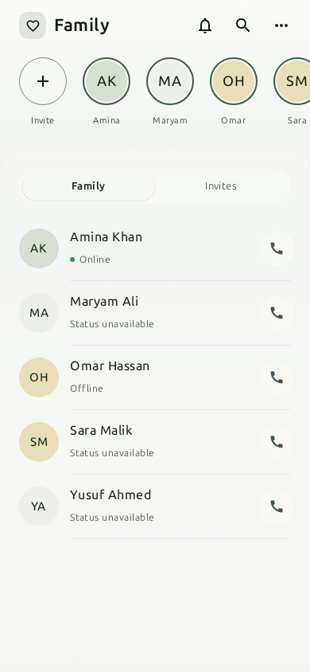 | 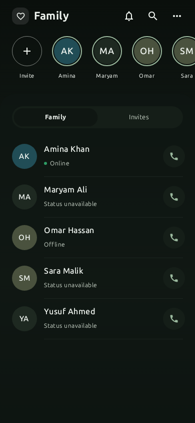 |

Full account IDs and removal options live in the contact sheet. Rows retain a large voice-call touch target and open accepted-family chat when tapped. Avatar shortcuts open the contact sheet. Message previews, timestamps and unread badges now accompany live presence; incoming/outgoing invitations remain on the Invites segment. The list panel fills the viewport even with few contacts.

## Chat and inbox

| Conversation | Message previews and badges | Notification inbox |
| --- | --- | --- |
| 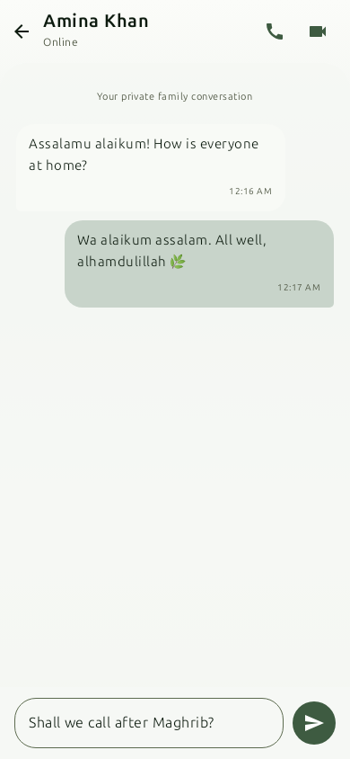 | 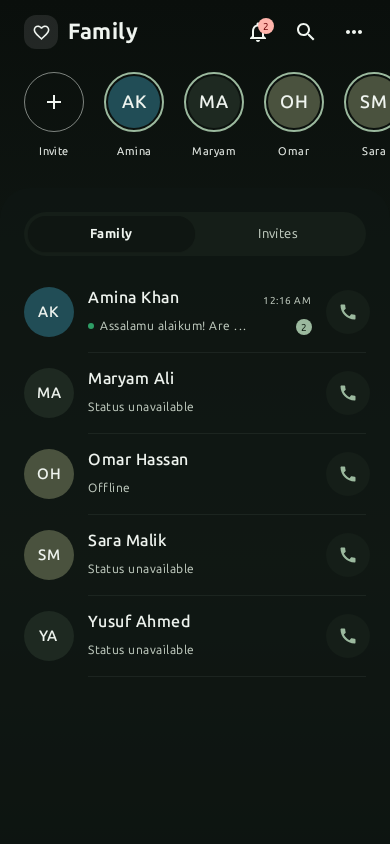 | 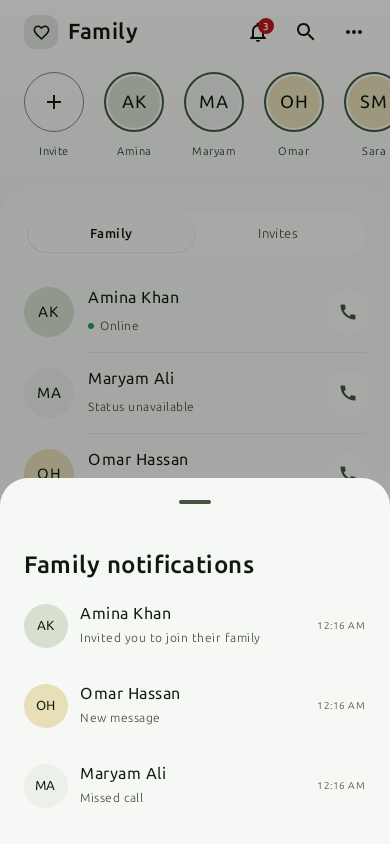 |

Only accepted members can open chat. The composer remains above the keyboard and the main navigation is hidden during a conversation. Inbox content covers invitations, messages and missed calls. Screenshots use fixtures; delivery and policy checks are covered separately by server/client tests.

## Landing

| Light | Dark |
| --- | --- |
| 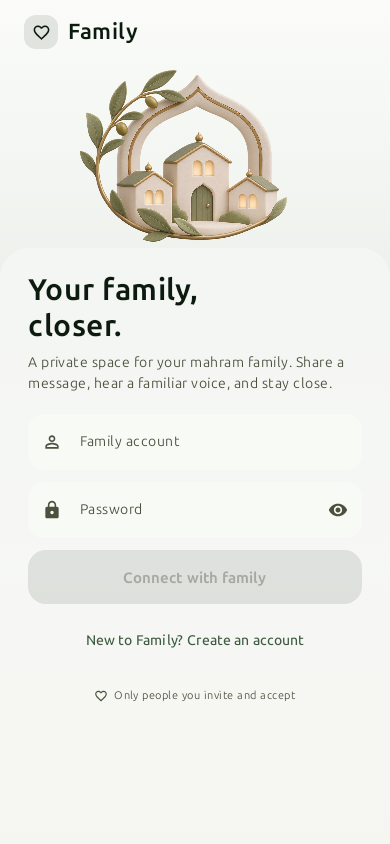 | 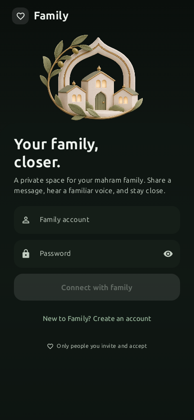 |

These fixtures show empty release-style fields and a disabled sign-in button. Debug builds retain the prefilled pilot account/password. The form supports password visibility, loading, error dismissal and keyboard scrolling. Product text does not expose debug/setup details.

## Calls and theme switching

| Incoming voice call | Active voice, dark | Different app theme |
| --- | --- | --- |
| 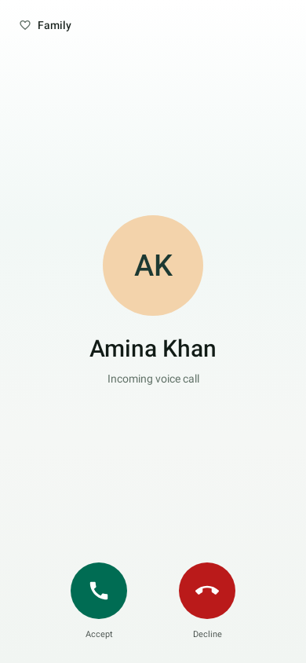 | 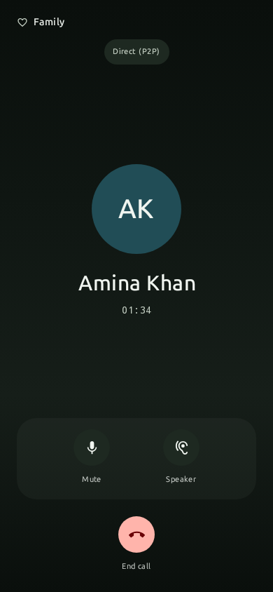 | 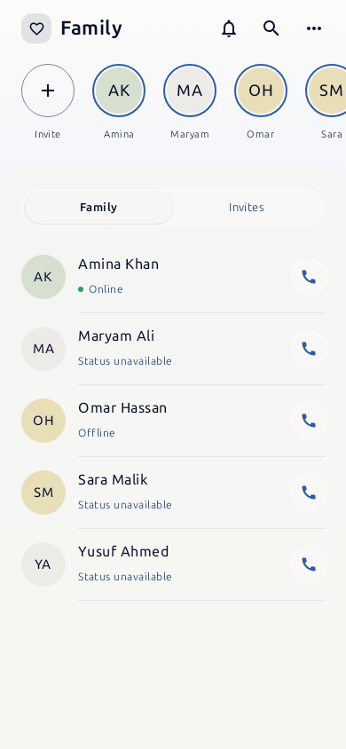 |

The contact page, illustration, avatar containers, fields and actions resolve theme roles. Native iOS reads the same shared palette and saved seed values. Mute/camera states have visible selected treatment and accessible labels. System-bar contrast changes for light voice surfaces versus video. Compact-height calls place hang-up beside the other controls.

Appearance settings now offer [curated themes](APPEARANCE_THEMES.md) with System/Light/Dark modes. Existing saved palettes, including those used in these snapshots, continue to render until another theme is selected.

## Video call

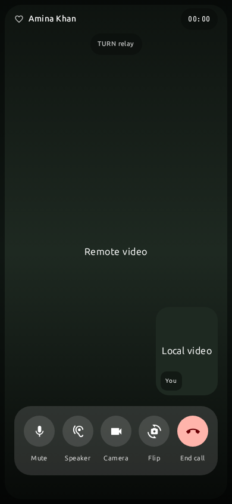

The media areas in this render are labeled fixtures, not camera frames. On a real call the remote feed fills the canvas and the local feed appears in the smaller thumbnail. The route pill reports the selected ICE path; voice renders show Direct (P2P), and this video fixture shows TURN relay. Neither fixture establishes a real device connection.

## Verification boundary

The Android demo-debug build, 33 shared Family policy/route tests, 53 targeted Android checks, 50 server tests with the real Jiffy codec and with the iodata fixture, and 13 installer/signup Python checks passed locally. The screenshot baselines were visually reviewed and then verified. Modified native iOS sources pass syntax parsing; this Linux environment cannot run Xcode or validate signed-device media. The VM smoke script now includes real chat delivery and unread checks, but needs execution on the deployed VM.

## Reproduce

```bash
./gradlew :app:testDemoDebugUnitTest \
  --tests '*FamilyScreenScreenshotTest' \
  -Proborazzi.test.record=false -Proborazzi.test.verify=true
```

To deliberately regenerate baselines after a reviewed layout change:

```bash
./gradlew :app:testDemoDebugUnitTest \
  --tests '*FamilyScreenScreenshotTest' \
  -Proborazzi.test.record=true -Proborazzi.test.verify=false
```

The suite covers light/dark landing and contacts, a second selected theme, incoming/active calls, search opening/closing and contact-sheet actions. Build the Android demo-debug APK and rebuild the iOS shared framework/app before device review. The chat/inbox update also requires the server deployment in [Family chat and inbox](FAMILY_CHAT.md).
