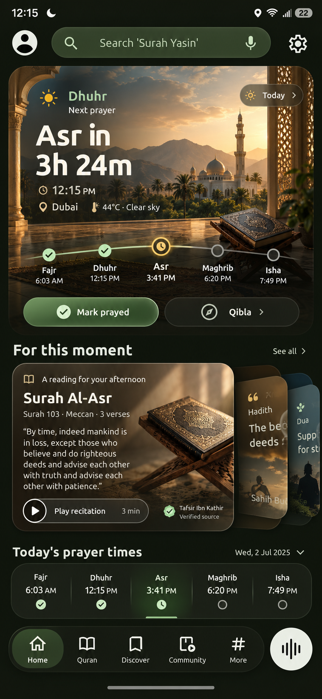
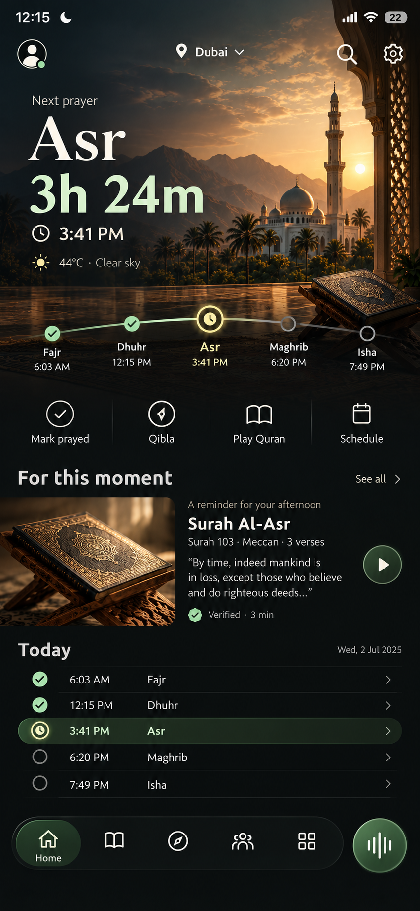

# Home R&D: Living Day

## Premium control variant

This refinement applies the hierarchy of a premium device-control app without
copying automotive branding or imagery. It removes most visible containers,
makes Prayer Now an edge-to-edge live surface, and places frequent actions in a
stable control dock. Recommendations become an editorial row and the schedule
becomes a precise list. Deenly's mosque, Quran, prayer, Qibla, and voice identity
remain the subject of the experience.

The recommended visual direction is this premium control variant. It is calmer
than the stacked-card study and gives morphing transitions clearer origins and
destinations.

## Product hypothesis

The home page should answer three questions in order:

1. What spiritual moment am I in now?
2. What is the most useful action for this moment?
3. What does the rest of my day look like?

The current home has strong photography and useful features, but the Insights
carousel and prayer grid compete for attention. Both behave like primary
dashboards. The proposed **Living Day** concept gives the current prayer one
visual anchor, places contextual content in a second-level deck, and keeps the
full schedule available in a compact timeline.

## Proposed hierarchy

### 1. Living prayer canvas

The hero combines the information users currently collect from several areas:

- current and next prayer
- countdown and local time
- location and weather
- five-prayer progress
- the two most relevant actions

The scene changes gradually with the real sky period. The prayer path advances
through the day without moving controls or changing the reading order. The
primary action changes by state: `Mark prayed`, `Prepare`, or `View next`.
Qibla remains a stable secondary action.

Tapping the hero morphs it into the existing immersive Prayer Now detail. The
prayer path becomes the expanded schedule rather than disappearing and being
recreated as a different component.

### 2. For this moment

Reading, hadith, dua, and recommendations become one ranked deck. Only the best
item is fully readable. Two restrained card edges indicate that more content is
available without showing a clipped half-card.

Ranking should use data the app already has:

- prayer window and weekday, including Jumu'ah
- completed prayers
- downloaded and verified sources
- reading history and saved items
- connectivity and asset availability

The front card contains a useful preview, source status, estimated duration,
and one action. Expanding it morphs into the immersive reader. Swiping changes
the recommendation; vertical scrolling remains reserved for reading content.

### 3. Today ribbon

The schedule defaults to a single compact ribbon. It highlights completed,
current, and next prayer states with shape and labels, not color alone. A tap
or upward drag morphs it into the current full prayer grid with notification,
adhan, and adjustment controls.

Location and weather move into the living canvas, removing the separate footer
card and reducing repeated information.

## Interaction model

| Gesture or action | Result |
| --- | --- |
| Tap prayer canvas | Morph into Prayer Now detail |
| Tap a prayer point | Preview that prayer without navigating |
| Drag schedule upward | Expand into the editable prayer grid |
| Swipe recommendation deck | Move between reading, hadith, and dua |
| Tap recommendation | Morph into its reader |
| Pull down | Preserve the existing sync, download, and media strip |
| Continue scrolling in an expanded reader | Enter immersive mode and hide navigation |

The hero, recommendation, and schedule each have one expansion axis. This
avoids the current ambiguity between horizontal paging, vertical content
scrolling, and whole-card expansion.

## Motion language

Motion should explain continuity instead of decorating every state change.

- **Prayer canvas to detail:** artwork scales and repositions; prayer labels
  travel to their expanded locations; the countdown remains anchored.
- **Recommendation to reader:** the card image becomes the reader header;
  title and source move into the toolbar; body text reveals below.
- **Ribbon to grid:** prayer points separate into cards along a spring with no
  crossfade between duplicated layouts.
- **Day progression:** sun, moon, sky color, and the prayer path move slowly.
  No looping attention animation is required.
- **Loading:** preserve the destination card's final height and reveal source
  search steps inside it, preventing the empty-space jump seen today.

Use short, critically damped motion for direct input and slower transitions for
time-of-day changes. Reduced Motion replaces spatial morphs with a short fade
and keeps all content in its final position.

## Visual rules

- Use one photographic focal surface above the fold.
- Keep recommendation artwork subordinate to the prayer canvas.
- Use an 8 dp spacing grid and shared 24–28 dp outer corner radii.
- Keep body text on solid or strongly scrimmed surfaces.
- Reserve translucent materials for controls and card depth, not long text.
- Keep a minimum 44 pt/dp target on both platforms.
- Support dynamic type by converting the schedule ribbon to two rows before
  truncating prayer names or times.
- Show verified/downloaded state next to the source, never as a floating badge
  without a label.

## Cross-platform implementation

The concept should be implemented in shared Compose so Android and iOS keep the
same hierarchy and state model. Platform differences remain at the shell:

- Android uses predictive back and Material system bars.
- iOS uses its safe-area and navigation dismissal behavior.
- Both use the existing shared `PrayerTimesScreen`, `InsightPager`, prayer day,
  Salah progress, playback bus, and contextual recommendation data.

The first spike should introduce three reusable shared components:

1. `LivingPrayerCanvas`
2. `MomentRecommendationDeck`
3. `PrayerDayRibbon`

They can sit behind a local development flag while the current home remains
the default. Existing detail screens, repositories, notification controls, and
download behavior remain the source of truth.

## Validation plan

Run a small staged comparison against the current home:

- time to identify the next prayer
- successful taps on the intended primary action
- recommendation opens and completed reading/listening sessions
- accidental horizontal/vertical gesture reversals
- home-to-detail transition frame time
- dynamic type, RTL, reduced motion, offline, missing asset, and tablet states

The concept is successful if users identify the next prayer faster, open more
contextual content, and make fewer corrective swipes while the home remains
stable during loading and expansion.

## Suggested delivery order

1. Build the compact prayer ribbon with real data and accessibility semantics.
2. Consolidate location, weather, countdown, and prayer progress into the hero.
3. Reuse the current insight sources in the ranked deck.
4. Add shared-element morphs after all resting and expanded layouts are stable.
5. Validate phones, tablets, RTL, large text, reduced motion, and low-power mode.

This order delivers hierarchy improvements before motion work and keeps each
stage independently reviewable.
